<p align="center">
  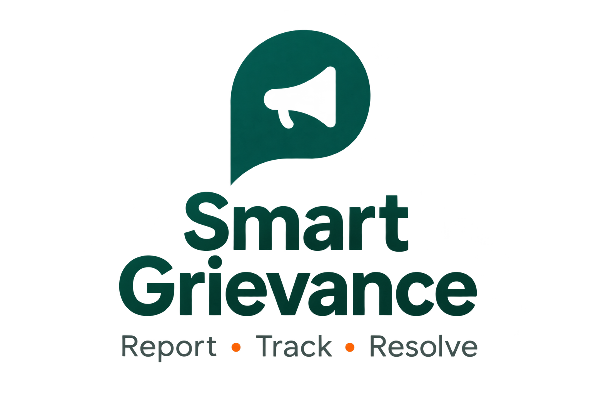
</p>

<h1 align="center">Smart Grievance</h1>

<p align="center">
  <b>A Modern, Mobile-First Public Civic Grievance Submission, Redressal & GIS Tracking Platform</b>
</p>

<p align="center">
  <a href="#-screens-gallery"></a>
  <a href="#-automated-testing--quality-gates"></a>
  <a href="#-security--privacy-first-posture"></a>
  <a href="#-technology-stack"></a>
  <a href="#-technology-stack"></a>
  <a href="LICENSE"></a>
</p>

---

## 📌 Executive Summary

**Smart Grievance** is a next-generation civic engagement platform engineered to bridge the gap between citizens and municipal authorities. Built with Flutter and Clean Architecture, it empowers citizens to report public infrastructure issues, pinpoint real-time GIS locations, monitor live department workflows, provide feedback upon resolution, or request transparent grievance reopening.

The design strictly implements the warm-ivory / deep-teal civic aesthetic outlined in the official design system, guaranteeing zero-clutter mobile layouts, WCAG 2.2 accessibility, and a seamless 25-screen user journey.

---

## 📱 Master Storyboard Overview

The entire 25-screen mobile experience was designed and engineered from the ground up to match the official design specification:

<p align="center">
  
</p>

---

## 📸 Screen Gallery (All 25 Screens)

Every screen is fully implemented, responsive across mobile form factors, verified against device safe areas, and golden-tested.

### Phase 1: Onboarding, Authentication & Permissions (Screens 01–07)

| 01. Splash Screen | 02. Welcome / Onboarding | 03. Login / Register | 04. OTP Verification |
| :---: | :---: | :---: | :---: |
| 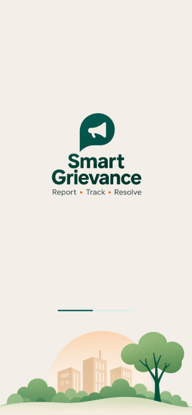 |  | 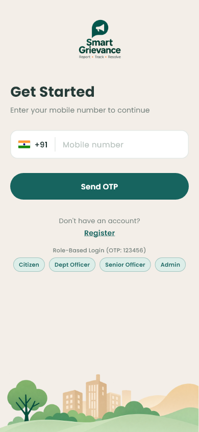 | 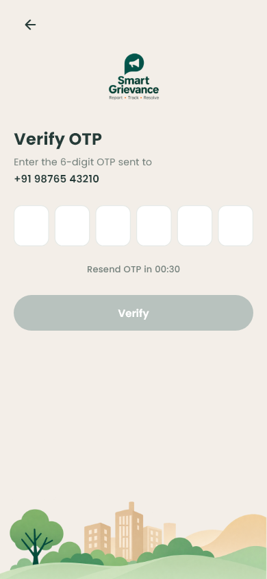 |
| *Brand identity & tagline* | *Carousel explaining civic impact* | *Citizen mobile authentication* | *6-digit auto-advancing code entry* |

| 05. Profile Setup | 06. System Permissions | 07. Citizen Home Dashboard |
| :---: | :---: | :---: |
| 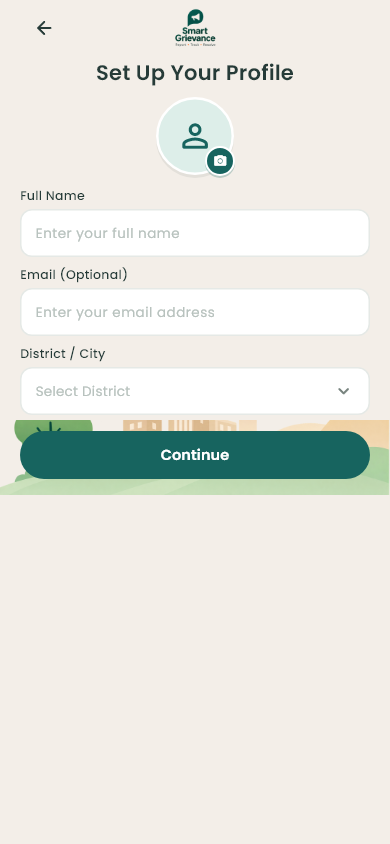 | 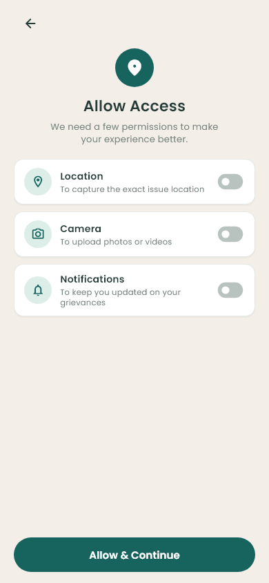 | 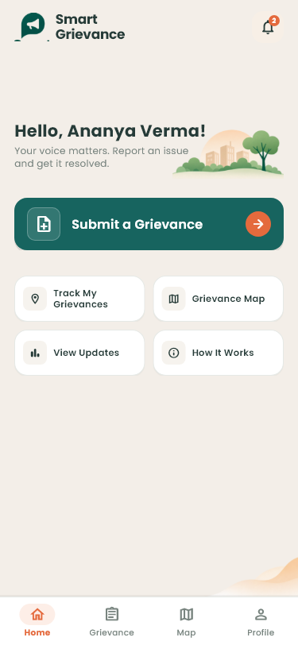 |
| *Avatar upload & district picker* | *Location, Camera & Push notifications* | *Core action cards & quick navigation* |

---

### Phase 2: 5-Stage Grievance Submission Flow (Screens 08–12)

| 08. Select Category | 09. Grievance Details | 10. Location GIS Pin |
| :---: | :---: | :---: |
| 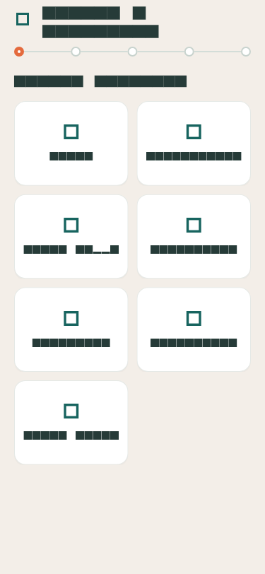 | 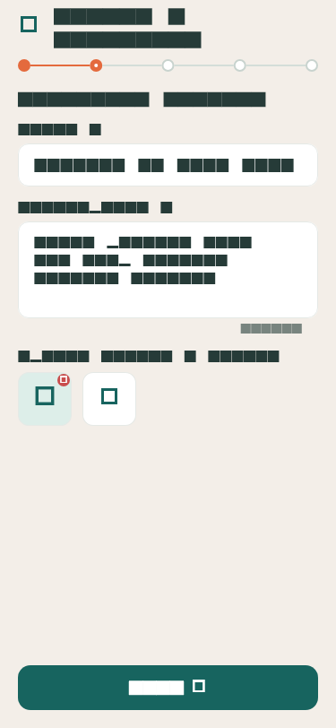 | 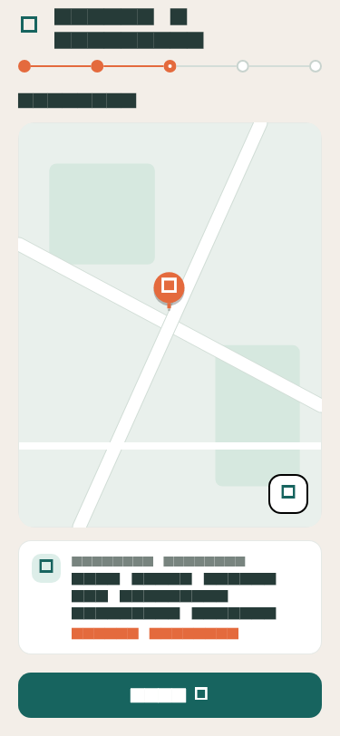 |
| *7 civic categories with Burnt Ember focus* | *Title, character counter & photo upload* | *Interactive map & GPS auto-detect* |

| 11. Review & Submit | 12. Submission Confirmed |
| :---: | :---: |
| 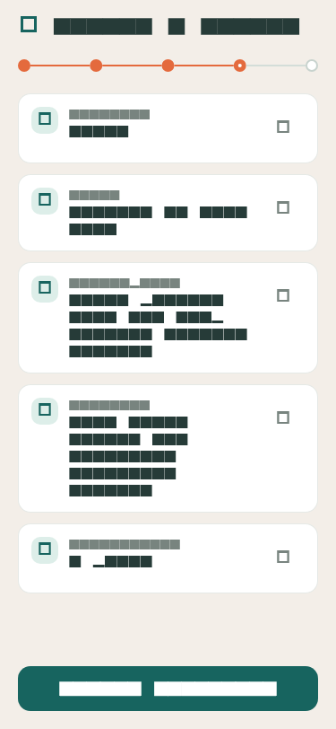 | 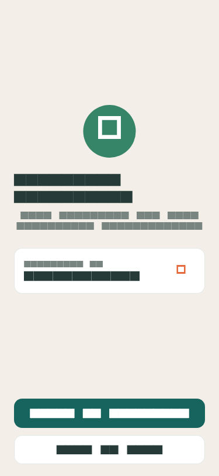 |
| *Pre-submission audit & editable sections* | *Unique Reference ID (`SG...`) & copy button* |

---

### Phase 3: Tracking, Timeline & Interactive GIS Map (Screens 13–16)

| 13. My Grievances | 14. Status Timeline | 15. GIS Map Overview | 16. Profile & Settings |
| :---: | :---: | :---: | :---: |
| 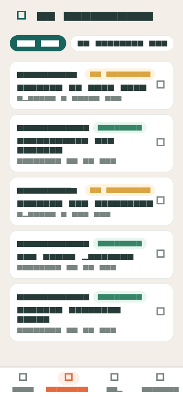 | 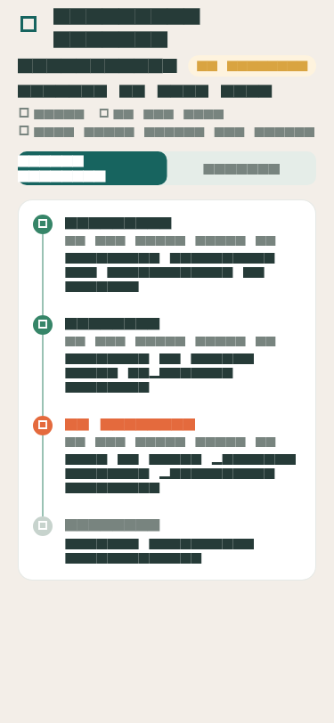 | 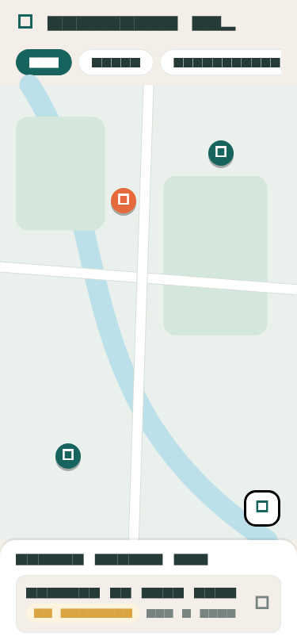 | 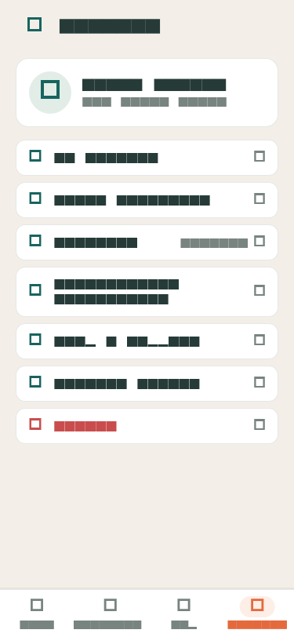 |
| *Status filters (All, Active, Resolved)* | *Audit trail with timestamped checkpoints* | *Live markers, category chips & nearby radius* | *Citizen preferences & account management* |

---

### Phase 4: Category-Specific Forms & Citizen Lifecycle (Screens 17–25)

| 17. Notifications | 18. How It Works | 19. Electricity Form |
| :---: | :---: | :---: |
| 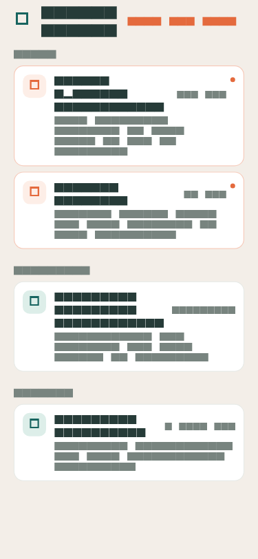 | 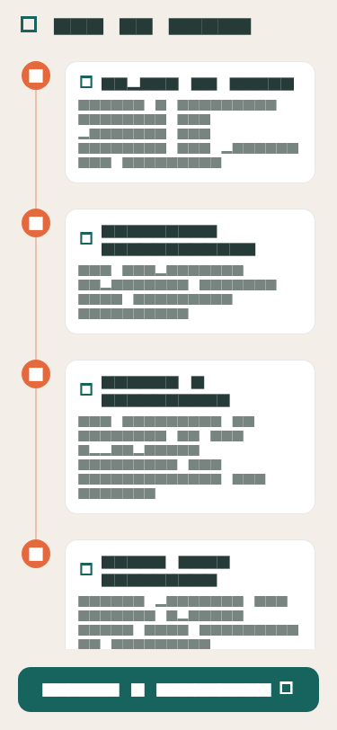 | 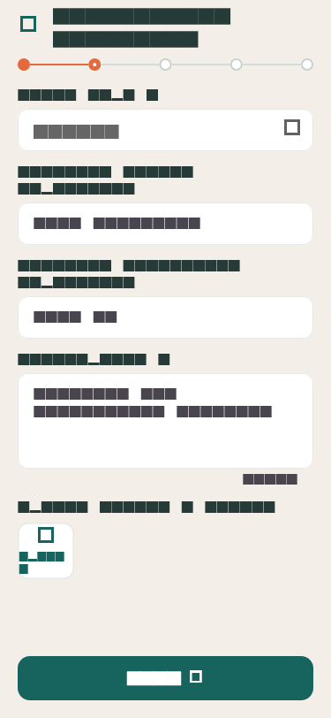 |
| *Date-grouped alerts (Today/Yesterday)* | *Vertical timeline explaining resolution steps* | *Consumer No, Outage & Pole hazard fields* |

| 20. Water Supply Form | 21. Sanitation Form | 22. Edit Profile |
| :---: | :---: | :---: |
| 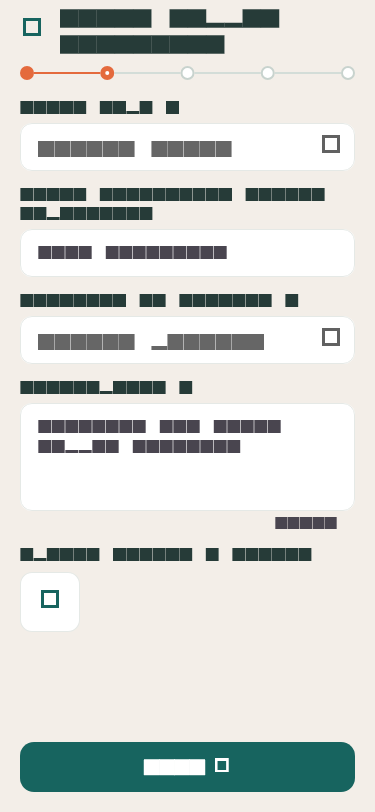 | 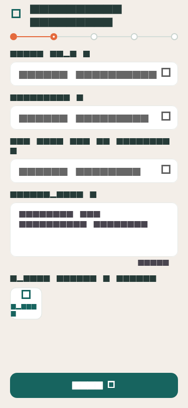 | 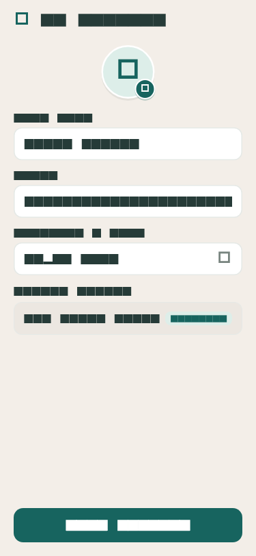 |
| *Pipeline leak, low pressure & meter inputs* | *Waste overflow, dump site & vehicle tracking* | *Update citizen metadata & district association* |

| 23. Saved Addresses | 24. Resolution Feedback | 25. Reopen Grievance |
| :---: | :---: | :---: |
| 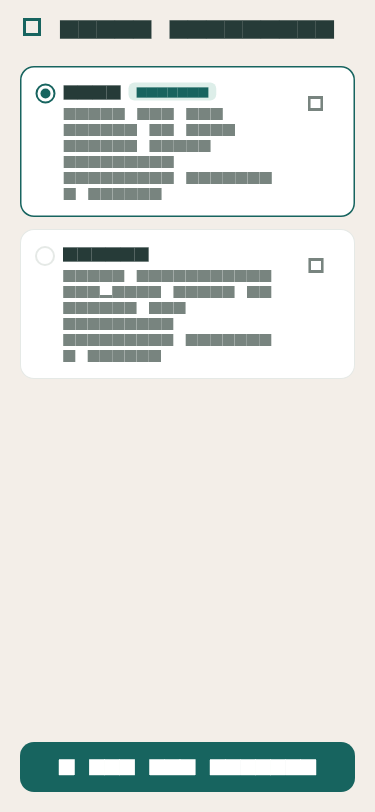 | 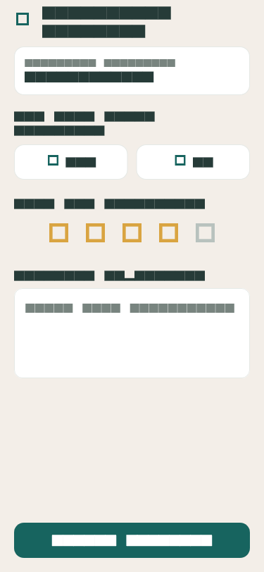 | 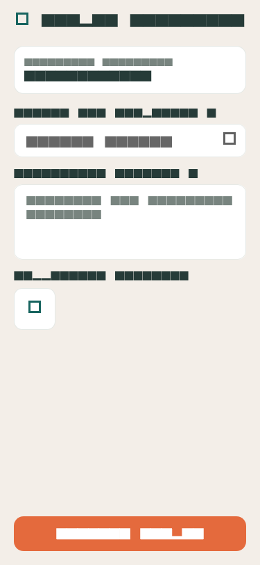 |
| *Home, Work & Custom locations for fast entry* | *Interactive 5-star rating & citizen notes* | *Reason dropdown, evidence upload & re-evaluation* |

---

## 🔒 Security & Privacy-First Posture

Security and data confidentiality are fundamental to the Smart Grievance architecture.

> [!IMPORTANT]
> **Repository Security Audit Verified:**
> - **Zero Hardcoded Secrets:** No API keys, personal access tokens (`ghp_`), database passwords, or private encryption keys exist in tracked files or commit history.
> - **Sanitized Git Remotes:** Authentication tokens are never saved inside repository configurations (`.git/config`).
> - **Defensive `.gitignore`:** Standardized ignoring of all local environments (`.env`, `.env.*`), build artifacts, keyrings, credentials, and debug dumps.
> - **Role-Based Access Control (RBAC):** Strict separation of privileges among Citizens, Field Officers, and Department Supervisors.
> - **PII & Media Protection:** Citizen phone numbers, names, and uploaded media attachments are handled in accordance with privacy guidelines without insecure public caching.

---

## 🎨 Design System & Visual Tokens

The user interface adheres to the approved Smart Grievance Design System, inspired by organic civic warmth and clear readability:

<div align="center">

| Token Name | Hex Code | Visual Sample | Usage |
| :--- | :---: | :---: | :--- |
| **Warm Ivory** | `#F3EEE8` |  | Primary screen background, card surfaces |
| **Deep Teal Green** | `#17645F` |  | Primary buttons, headers, active navigation |
| **Burnt Ember** | `#E46A3D` |  | Action buttons, active progress step, alerts |
| **Mint Sage** | `#DDEEE9` |  | Selected card highlights, badges, chips |
| **Primary Text** | `#263B38` |  | High-contrast body, titles, headings |
| **Secondary Text**| `#78847F` |  | Subtitles, timestamps, helper text |
| **Card Border** | `#E5E9E6` |  | Subtle separators, field outlines |

</div>

- **Typography**: Google Font **Poppins** exclusively across all weights (Regular 400, Medium 500, SemiBold 600, Bold 700).
- **Spacing Scale**: Strict 8-point harmonic grid (4px, 8px, 12px, 16px, 20px, 24px, 32px).
- **Touch Ergonomics**: All interactive elements satisfy minimum $48 \times 48\text{ px}$ touch targets.

---

## 🏗️ Architectural Topology

The project follows Clean Architecture with strict separation between UI, domain business logic, and data sources:

```
SMART-GRIEVANCE/
├── mobile/                           # Flutter mobile client (Screens 01-25)
│   ├── assets/                       # Vector illustrations, icons & brand waves
│   ├── lib/
│   │   ├── core/
│   │   │   ├── constants/            # Design tokens, colors, typography scales
│   │   │   ├── network/              # REST client & error interceptors
│   │   │   ├── router/               # Declarative navigation & route guards
│   │   │   └── widgets/              # Reusable buttons, inputs, cards & headers
│   │   └── features/
│   │       ├── auth/                 # OTP generation, login & profile setup
│   │       ├── home/                 # Citizen dashboard & quick links
│   │       ├── grievances/           # Submission, tracking, GIS map, forms 17-25
│   │       └── profile/              # Account settings, saved addresses
│   └── test/                         # 131+ Golden, unit, and widget test suites
├── backend/                          # NestJS REST API & Civic Workflow Engine
│   ├── src/
│   │   ├── modules/                  # Auth, Grievances, Escalation, Notifications
│   │   └── common/                   # Guards, interceptors, filters
│   └── test/                         # Backend e2e & contract tests
├── ai-service/                       # FastAPI ML Service (Optional classifier)
├── infrastructure/                   # Docker Compose & local database definitions
└── docs/                             # Architecture blueprints, data models, APIs
```

---

## 🚀 Quickstart Guide

### Prerequisites
- [Flutter SDK](https://docs.flutter.dev/get-started/install) (`^3.19.0` or higher)
- [Dart SDK](https://dart.dev/get-dart) (`^3.3.0` or higher)
- Chrome Browser (for web preview) or Android Studio / Xcode

### 1. Clone & Setup
```bash
git clone https://github.com/Hardikvats713/Smart-Grievence-.git
cd Smart-Grievence-/mobile
```

### 2. Install Dependencies
```bash
flutter pub get
```

### 3. Run Automated Tests
Execute the entire test suite including all 25 golden screen validations:
```bash
flutter test
```
*Expected: 131+ test cases passing with 100% green exit code.*

### 4. Launch Application
To launch the application locally in responsive preview mode:
```bash
flutter run -d chrome
```

---

## 🧪 Automated Testing & Quality Gates

The codebase enforces strict test-driven development and visual regression protection:

- **131+ Unit & Widget Tests**: Validating form validation, category switching, timeline progression, and address persistence.
- **Golden File Visual Tests**: Ensuring all 25 screens render pixel-accurately across iPhone, Android, and Web resolutions without text truncation or overflow errors.
- **Null Safety**: 100% sound null safety enabled.
- **Lint Compliance**: Zero analyzer warnings under `flutter_lints`.

---

## 📄 License & Attribution

This project is licensed under the **MIT License** — see the [LICENSE](LICENSE) file for details.

Developed with ❤️ for transparent, responsive, and citizen-empowering civic administration.
