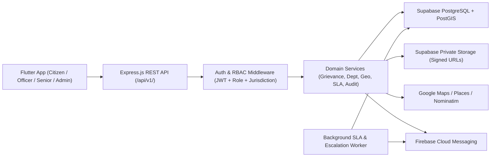

# Backend Architecture — Smart Grievance

## 1. System Overview
Smart Grievance uses a **single Flutter application** for all four roles (`CITIZEN`, `DEPARTMENT_OFFICER`, `SENIOR_OFFICER`, `ADMINISTRATOR`) backed by a **Node.js + Express REST API (`/api/v1/`)** and **Supabase PostgreSQL (with PostGIS)** + **Supabase Storage**.

## 2. Core Architectural Principles
- **Server-Side Authorization:** Every `/api/v1/` endpoint derives user identity, roles, department, and geographical jurisdiction from the verified JWT and database—never from client-submitted IDs.
- **Normalized Relational Schema:** UUID primary keys, foreign keys, check constraints, PostGIS `geography(Point, 4326)` for grievance coordinates, and append-only `grievance_status_history`.
- **Private Media Storage:** Evidence files are stored in private Supabase Storage buckets and accessed only via short-lived signed URLs.
