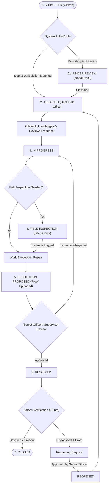

# Department Workflow & Investigation Lifecycle Specification
## Smart Grievance Management Information System — Arunachal Pradesh

### 1. Department Operational Flow
Each civic grievance submitted by a citizen follows an operational path managed through role-based access in the Flutter app and enforced server-side.

---

### 2. Officer Responsibilities & Capabilities

#### Level 1: Field Officer (`DEPARTMENT_OFFICER`)
- **Queue Triage:** Receives push notifications of new complaints routed to their department and assigned ward/locality.
- **Site Inspection:** Uses the mobile app on-site to record GPS-verified inspection notes and upload survey photos.
- **Investigation Remarks:** Adds internal notes for team members regarding repair estimates, required materials, or contractor coordination.
- **Resolution Proof:** Uploads mandatory photographic evidence of completed repair/work before requesting resolution.
- **Status Advancement:** Permitted transitions: `ASSIGNED` $\rightarrow$ `IN_PROGRESS` $\rightarrow$ `FIELD_INSPECTION` $\rightarrow$ `RESOLUTION_PROPOSED`.

#### Level 2: Sub-Divisional Officer / Senior Officer (`SENIOR_OFFICER`)
- **Supervisory Review:** Reviews all `RESOLUTION_PROPOSED` grievances across their sub-division or district.
- **Resolution Approval:** Approves resolution transitioning status to `RESOLVED`, or returns complaint to `IN_PROGRESS` with written rejection remarks if work is substandard.
- **Escalation Intervention:** Receives auto-escalations when field officers breach SLA warning thresholds (L1) or hard deadlines (L2).
- **Reopening Adjudication:** Reviews citizen reopening claims. If genuine, approves reopening and reassigns with priority.

#### Level 3: Department Administrator / District Magistrate (`ADMINISTRATOR`)
- **Capacity Management:** Rebalances officer workload across municipal wards.
- **Policy Tuning:** Modifies SLA hours, priority weights, and escalation warning periods.
- **System-Wide Analytics:** Audits cross-department resolution performance, recurring hotspot areas, and citizen satisfaction ratings.
