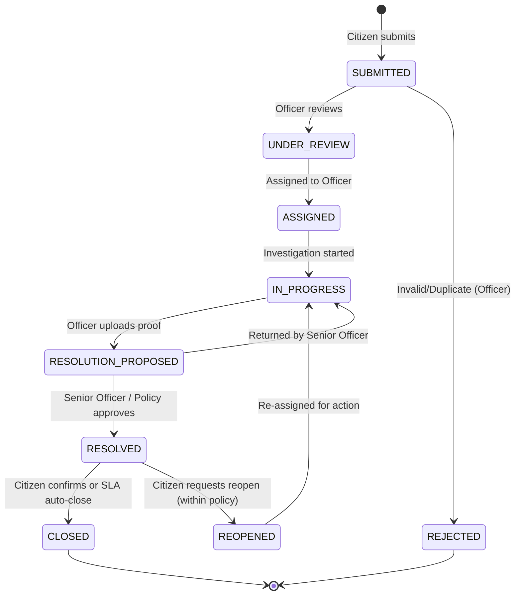

# Grievance Lifecycle & State Machine

## Permitted Transitions
- **Backend-Enforced:** Arbitrary status updates from the Flutter client are rejected with `400 Bad Request` or `403 Forbidden`.
- **Append-Only History:** Every transition inserts a row into `grievance_status_history` with `previous_status`, `new_status`, `changed_by`, `action_type`, and `comment`.
