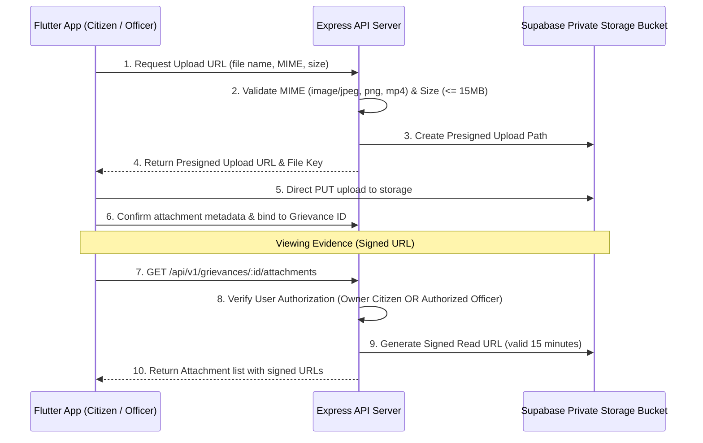

# Media Evidence & Private Storage Architecture
## Smart Grievance Management Information System — Arunachal Pradesh

### 1. Storage Architecture Overview
All uploaded citizen evidence, officer site surveys, and resolution proofs are stored in private Supabase Storage buckets. Direct public read access is forbidden.

---

### 2. Bucket Organization & Quotas
- **Bucket: `grievance-evidence` (Private)**
  - Path pattern: `{grievance_id}/{attachment_type}_{timestamp}_{random}.{ext}`
  - Example: `b1a2c3d4/CITIZEN_EVIDENCE_1732525200_a9f1.jpg`
  - Max file size: 10 MB per image, 25 MB per video. Max 5 attachments per grievance.
- **Bucket: `resolution-proof` (Private)**
  - Path pattern: `{grievance_id}/RESOLUTION_PROOF_{timestamp}_{random}.{ext}`
  - Strictly officer-uploaded visual proof of repaired public asset.
- **Bucket: `avatars` (Public/Private CDN)**
  - User profile pictures. Max file size: 2 MB. Allowed types: `image/jpeg`, `image/png`.

---

### 3. Signed URL Expiration Policy
- All temporary read URLs generated via `@supabase/supabase-js` `createSignedUrl` expire after **900 seconds (15 minutes)**.
- Flutter mobile app caches loaded images in local memory/cache directory (`cached_network_image`) to avoid re-requesting signatures unnecessarily while browsing within the same session.
