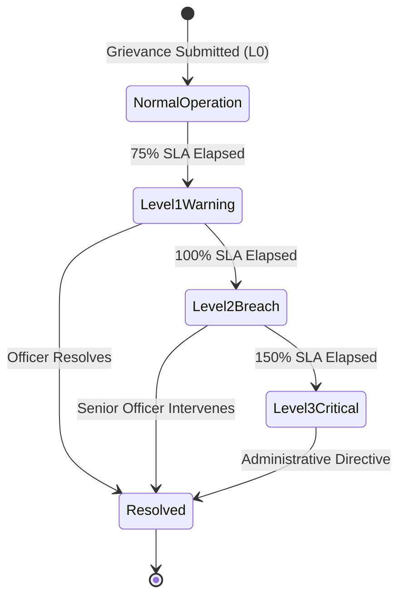

# SLA Policies & Automated Escalation Engine
## Smart Grievance Management Information System — Arunachal Pradesh

### 1. SLA Matrix by Priority and Category
To prevent bureaucratic delays, every grievance has a deterministic Service Level Agreement (SLA) resolution window calculated upon submission:

| Priority Level | Target Resolution Window | Warning Trigger (L1 - 75%) | Breach Escalation (L2 - 100%) | Severe Breach (L3 - 150%) | Typical Categories |
|---|---|---|---|---|---|
| **CRITICAL** | **24 hours** | 18 hours | 24 hours | 36 hours | Live exposed electric wire, contaminated drinking water, major bridge collapse |
| **HIGH** | **48 hours** | 36 hours | 48 hours | 72 hours | Transformer burnout, major pipeline burst, hospital clinic supply failure |
| **MEDIUM** | **72 hours** | 54 hours | 72 hours | 108 hours | Road potholes, streetlight outage, blocked drainage, school roof leak |
| **LOW** | **120 hours (5 days)** | 90 hours | 120 hours | 180 hours | General municipal inquiries, public garbage bin relocation, tree trimming |

---

### 2. Escalation Tier Workflow



#### Tier 1: Warning (75% Elapsed)
- Automated push alert sent to assigned Department Field Officer.
- Visual status tag in mobile app changes to amber `Nearing Breach`.

#### Tier 2: Senior Officer Escalation (100% Elapsed)
- Field officer loses exclusive hold; grievance becomes visible on the District Senior Officer's priority queue.
- An immutable entry is written to `escalation_records`.
- Red `Breached` badge displayed in all dashboards.

#### Tier 3: Executive Escalation (150% Elapsed)
- Escalated to District Magistrate / Department Head for disciplinary review.
- Logged in the government transparency performance portal.

---

### 3. Background Escalation Engine Implementation
A scheduled cron service runs every 15 minutes (`*/15 * * * *`) executing the following check:
```sql
-- Find active unresolved grievances approaching or exceeding SLA
SELECT id, reference_number, department_id, assigned_officer_id, sla_deadline, escalation_level,
       EXTRACT(EPOCH FROM (now() - created_at)) / 3600 AS elapsed_hours,
       EXTRACT(EPOCH FROM (sla_deadline - created_at)) / 3600 AS total_sla_hours
FROM public.grievances
WHERE status NOT IN ('RESOLVED', 'CLOSED', 'REJECTED')
  AND now() >= (created_at + ((sla_deadline - created_at) * 0.75));
```
